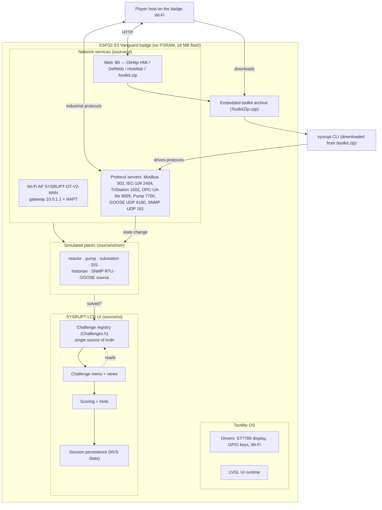

# Architecture

SYSRUPT OT Range V2 is a self‑contained OT/ICS capture‑the‑flag range that runs entirely on a single
ESP32‑S3 badge. It is implemented as a **Tactility OS device** (`Devices/vanguard/`): Tactility
provides the OS, display/input drivers, LVGL UI stack and Wi‑Fi; SYSRUPT adds the simulated plants,
protocol servers, the LCD challenge UI, scoring/persistence and the embedded player toolkit.

> This document describes the current implementation. Ports, challenge numbers and the points table are
> taken from the source (`source/ui/Challenges.h`, `source/ot/*`). Protocol servers are **training
> simulations**, not full standard stacks — see [Protocol realism](#protocol-realism).

## Component overview



## Firmware structure

```
Devices/vanguard/
  source/
    ot/           network-facing range
      sim/        simulated plants (pure logic, host-testable): reactor, pump, historian,
                  substation, SIS, SNMP device, GOOSE source, SQLi simulator …
      net/        protocol servers + :80 web server (OtHttp, DefWeb, HistWeb) + ToolkitZip
      *.cpp/.h    per-protocol Service wrappers (Iec104Service, SisService, …) that own the
                  listener task and bridge a sim to the network
      ui/         OT-specific UI helpers
    ui/           LCD UI: challenge registry, menu, per-challenge view, scoring, NVS persistence
  test/           host-side C++ unit tests (run_all.sh)
  tools/sysrupt/  player-side Python CLI + release packaging + embedded-ZIP generator
  docs/           this documentation
  bi0s,vanguard.dts   devicetree (display, SPI bus, keypad pin map)
  device.properties   Tactility device descriptor (target, flash, display, sdkconfig overrides)
  module.yaml         Tactility module deps (platform + drivers) and the DTS reference
```

## Tactility integration

The badge is a Tactility **device module** (`module.yaml`) that depends on `Platforms/platform-esp32`
and the `st7789-module` / `gpio-keys-module` drivers, and points at `bi0s,vanguard.dts` for the board
devicetree. `device.properties` declares the hardware target (ESP32‑S3, 16 MB flash, no PSRAM,
internal storage only), the display geometry, and the `sdkconfig` overrides the range needs (IP
forwarding + NAPT, a larger lwIP socket pool). The launcher app id (`vanguard.menu`) boots straight
into the challenge‑selection menu rather than the generic Tactility launcher.

## Challenge registration and dispatch

`source/ui/Challenges.h` is the **single source of truth** for the catalogue. Two `constexpr` arrays —
`CHALLENGES[]` (offensive) and `DEFENSIVE[]` — hold each challenge's number, name, one‑line brief,
backend kind, category, difficulty, points, story, objectives, protocol and access string. The
category‑select screen, the challenge list and the per‑challenge overview all read these arrays; there
is no separate catalogue to keep in sync.

`startAllServices()` brings up every network backend once (race‑safe, idempotent) so the whole range
is attackable from any LCD screen, not just the menu. Each challenge's "solved" state is derived from
the live backend (e.g. a reactor safe‑band bitmask held for N seconds, a restored historian record), so
completion is detected over the network regardless of which screen is open. A watcher posts newly
completed challenge numbers; the shared **Challenge Complete** screen then appears on whichever view is
foreground.

## Offensive vs. defensive architecture

- **Offensive** challenges (`CHALLENGES[]`, 7) ask the player to *make the process do something* over
  an industrial protocol — trip a breaker, bypass a safety trip, forge a GOOSE event, hold a reactor in
  its safe band. Solved state comes from the simulated plant reaching the target condition.
- **Defensive** challenges (`DEFENSIVE[]`, 4) are investigation / recovery / submission tasks served
  from the shared `DefService` web surface (`:80` — `/mail`, `/intranet`, `/investigate`) plus the SNMP
  RTU. Completion is a verified submission or a restored/verified device state. #07 extracts a flag by
  SQL injection and submits it; #08 restores an RTU over SNMP; #09 restores a deleted record; #10
  identifies an impostor device from saved evidence.

See [CHALLENGES.md](CHALLENGES.md) for the spoiler‑free catalogue.

## Scoring and completion logic

Points are difficulty‑weighted and defined per challenge in the registry. `SCORE_MAX` is computed at
compile time by summing every challenge's points and is guarded by a `static_assert`:

```cpp
static_assert(SCORE_MAX == 2500, "Total attainable score must be exactly 2500 across the 11 challenges");
static_assert(CHALLENGE_COUNT + DEFENSIVE_COUNT == 11, "Exactly 11 active challenges expected");
```

Each of the two hint tiers per challenge (`GET STARTED` 10 pts, `IMPORTANT LEAD` 20 pts) permanently
deducts its cost when revealed. `netScore() = earnedScore() − hintPenaltyTotal()`, floored at 0.

## NVS persistence

Completion is persisted to the internal `/data` store (NVS) as a per‑challenge record, written on the
completion edge and idempotent (a challenge already recorded is never re‑awarded). A plain reboot
restores the session; only **Reset Session** clears it. Because persistence is keyed by challenge
number, a previously completed challenge stays complete across firmware updates without wiping NVS.

## Web server and embedded toolkit

The `:80` server (`source/ot/net`) hosts the HMI (`OtHttp`), the defensive web surface (`DefWeb`:
`/mail`, `/intranet`, `/investigate`), the historian console (`HistWeb`) and the toolkit download at
`/toolkit.zip`. The toolkit ZIP is **embedded in the firmware** as a byte array
(`source/ot/net/ToolkitZip.cpp`), generated from the release archive:

1. `tools/sysrupt/make_release.py` builds `release/sysrupt-toolkit-1.0.0.zip` deterministically.
2. `tools/sysrupt/gen_embedded_zip.py` regenerates `ToolkitZip.{h,cpp}` from that ZIP, storing the
   bytes and their SHA‑256.
3. The host test `ot_toolkitzip_tests` asserts the embedded bytes equal the release ZIP byte‑for‑byte.

This keeps the downloadable toolkit and the firmware‑embedded copy provably identical. See
[TOOLKIT.md](TOOLKIT.md).

## Networking

The badge runs its own Wi‑Fi AP (`SYSRUPT-OT-V2-NNN`, gateway `10.0.1.1`) with IPv4 forwarding and
NAPT enabled, so the narrative "zone" addresses (`10.0.2.x`–`10.0.5.x`) are reachable through the
badge. The lwIP socket pool is raised (`CONFIG_LWIP_MAX_SOCKETS=16`) because the range runs several
concurrent protocol listeners plus accepted client sockets.

## Test organization

Host‑side C++ unit tests (`test/`, run by `test/run_all.sh`) cover the simulated plants and protocol
logic without hardware. The Python toolkit has its own `pytest` suite. See [TESTING.md](TESTING.md).

## Protocol realism

The protocol servers are **bounded training re‑implementations**, sized to run on a no‑PSRAM ESP32‑S3
and to teach a specific concept — not complete, conformant industry stacks:

- **Modbus/TCP** — a function‑subset server over TCP 502.
- **IEC 60870‑5‑104** — a reduced APDU/ASDU set for the breaker scenario, TCP 2404.
- **TriStation‑lite** — a simplified safety‑controller protocol (not Triconex TriStation), TCP 1502.
- **OPC‑UA‑lite** — a custom, non‑standard service on a non‑standard port (9005); **not** standard
  OPC‑UA and not on 4840.
- **GOOSE (training)** — a GOOSE‑shaped exercise carried over **UDP 6180**, not raw Layer‑2 Ethernet
  multicast.
- **SNMP** — a small agent sufficient for the recovery workflow, UDP 161.
- **Historian SQL injection** — a **bounded pattern‑matching simulator**, deliberately **not** a real
  SQL engine (no SQLite), so the injectable surface is safe and self‑contained.

Treat protocol names as "the concept this challenge teaches," not a claim of standard conformance.
