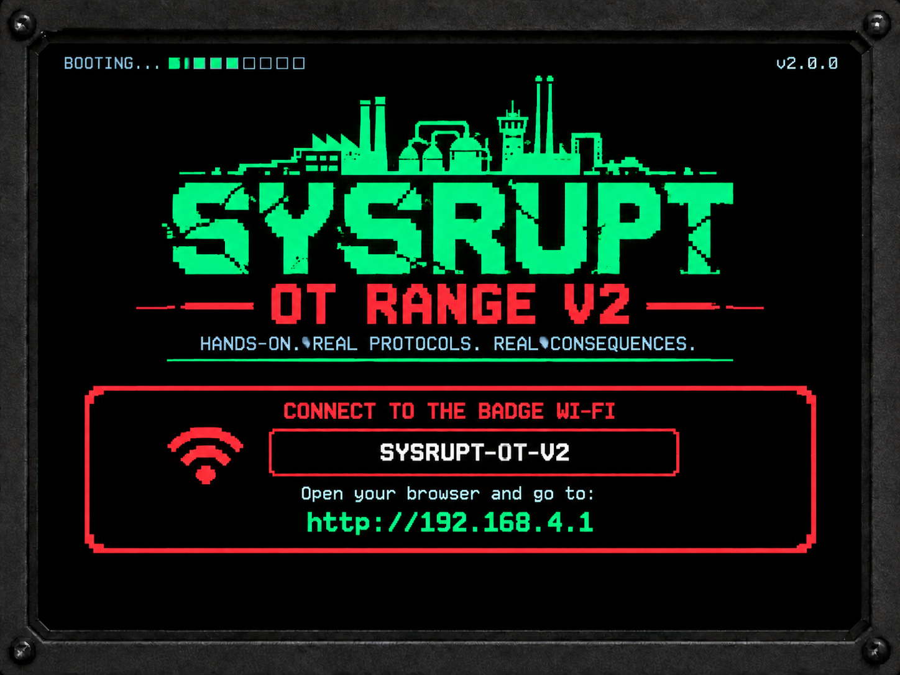
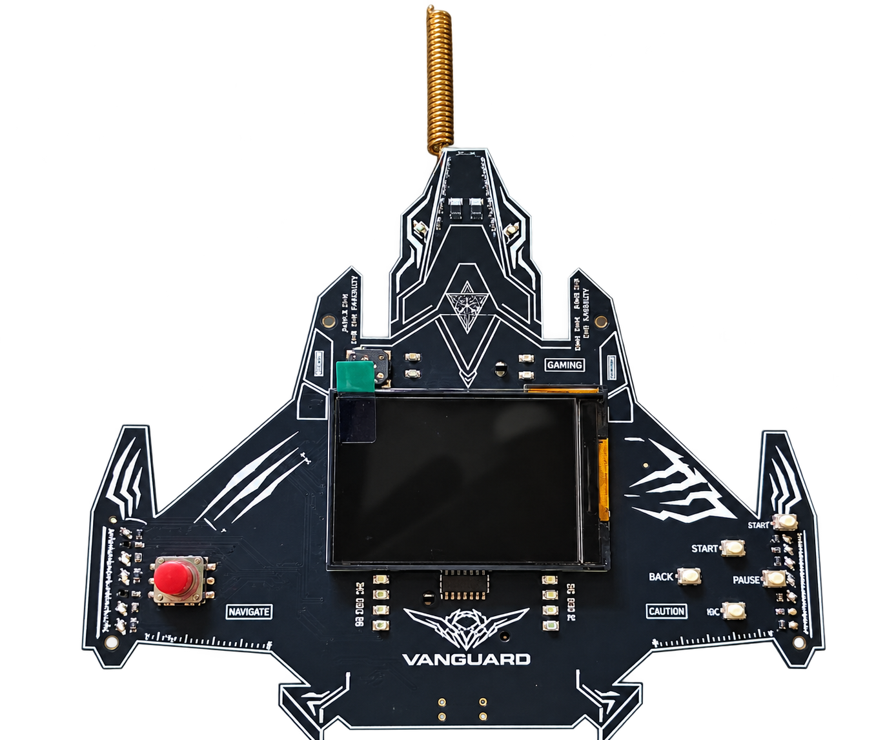

<h1 align="center">SYSRUPT Portable OT Range V2</h1>

<p align="center">
  <strong>Join a Wi-Fi network. Hack a power plant. Learn ICS/SCADA security.</strong><br/>
  A complete OT/ICS hacking range that runs on a single ESP32-S3 badge.
</p>

<p align="center">
  
  
  
  
  
</p>

<p align="center">
  
</p>

<p align="center">
  
  <br/>
  <em>The &ldquo;Vanguard&rdquo; ESP32-S3 badge.</em>
</p>

---

## What is it?

The **SYSRUPT Portable OT Range V2** is an industrial-cybersecurity training lab that fits on **one
ESP32-S3 &ldquo;Vanguard&rdquo; badge**. Flash the badge, join its Wi-Fi, and it *becomes* the control
network of a small simulated plant &mdash; a web HMI, a process historian and several real industrial
protocols &mdash; with **11 CTF challenges** across offensive exploitation and defensive investigation.

No cloud, no internet, no extra hardware. Your score and progress show on the badge's **320&times;240
LCD** and survive a reboot.

> Built as a fork of **[Tactility OS](https://tactilityproject.org)**. All SYSRUPT code lives under
> **[`Devices/vanguard/`](Devices/vanguard/)**.

## Live process HMI

The operator HMI at `http://10.0.1.1/hmi` renders the plant as a live, animated process mimic with real
gauges &mdash; and attacks have **visible impact**: drive the reactor out of its safe band and the status
changes; trip the bay breaker and the protection panel flips state.

<p align="center">
  
</p>

## Quick start

```bash
# 1. Flash the badge (preserves saved progress; add --erase for a clean wipe)
./flash_badge.sh -p /dev/ttyACM0 -y

# 2. Join the open Wi-Fi:  SYSRUPT-OT-V2-...
#    Your laptop gets a 10.0.1.x address; the badge is 10.0.1.1

# 3. Open the operator HMI, and grab the toolkit from the badge
firefox http://10.0.1.1/
curl -O http://10.0.1.1/toolkit.zip
unzip toolkit.zip && cd sysrupt-toolkit-1.0.0
./bin/sysrupt status          # read-only probe of the challenge ports
```

Building from source instead? One Docker command &mdash; see **[INSTALL.md](INSTALL.md)**.

> **Be gentle.** The ESP32-S3 has no PSRAM and a tiny network stack. Use **one connection at a time, low
> rate**. An aggressive `nmap -T4` sweep makes ports read *filtered*, not &ldquo;closed&rdquo;.

## Challenges

**11 challenges &mdash; 7 offensive, 4 defensive &mdash; 2500 points total.** The badge detects
completion over the network and updates the scoreboard automatically. (IDs skip **#05**, retired during
de-duplication.)

| # | Challenge | Type | Difficulty | Pts | What you'll do |
|---|-----------|------|-----------|-----|----------------|
| 01 | Tripping Breaker | Offensive | Hard | 250 | Control a substation breaker over IEC-104 |
| 02 | Safety Instrumented Bypass | Offensive | Hard | 250 | Defeat a safety-controller write-lock while the checksum still validates |
| 03 | OPC Scout | Offensive | Medium | 150 | Browse an address space and reach an unlinked node |
| 04 | Rogue Radio | Offensive | Hard | 200 | Analyse a capture and craft a fresh (non-replay) pump command |
| 06 | Second Blackout | Offensive | Expert | 300 | Observe a GOOSE stream and forge an accepted state change |
| 07 | Historian SQL Injection | Defensive | Hard | 250 | Find the hidden historian console, inject, extract and submit the flag |
| 08 | Field Device Recovery | Defensive | Hard | 250 | Investigate a tampered RTU and restore it over SNMP |
| 09 | Trojan Historian | Defensive | Medium | 150 | Diff the live vs. backup trends and restore the deleted record |
| 10 | Device Takeover | Defensive | Easy | 100 | Identify an impostor device from a saved capture |
| 11 | Stabilise the Reactor | Offensive | Expert | 300 | Map HMI values to Modbus registers and hold a safe state |
| 12 | Maintenance Override | Offensive | Expert | 300 | Beat a write-protect + reconciliation loop so a value persists |

**Full solution walkthroughs** live in **[`docs/challenges/`](docs/challenges/)** &mdash; one `chNN.md`
per challenge. (Trojan Historian, `ch09.md`, is a spoiler-free guide only.)

| Challenge | Guide | | Challenge | Guide |
|-----------|-------|-|-----------|-------|
| 01 &middot; Tripping Breaker | [ch01.md](docs/challenges/ch01.md) | | 09 &middot; Trojan Historian | [ch09.md](docs/challenges/ch09.md) |
| 02 &middot; Safety Instrumented Bypass | [ch02.md](docs/challenges/ch02.md) | | 10 &middot; Device Takeover | [ch10.md](docs/challenges/ch10.md) |
| 03 &middot; OPC Scout | [ch03.md](docs/challenges/ch03.md) | | 11 &middot; Stabilise the Reactor | [ch11.md](docs/challenges/ch11.md) |
| 04 &middot; Rogue Radio | [ch04.md](docs/challenges/ch04.md) | | 12 &middot; Maintenance Override | [ch12.md](docs/challenges/ch12.md) |
| 06 &middot; Second Blackout | [ch06.md](docs/challenges/ch06.md) | | | |
| 07 &middot; Historian SQL Injection | [ch07.md](docs/challenges/ch07.md) | | | |
| 08 &middot; Field Device Recovery | [ch08.md](docs/challenges/ch08.md) | | | |

## Protocols & ports

Everything is served from the single badge AP at `10.0.1.1`. Each service is a **bounded training
re-implementation** sized for the ESP32-S3 &mdash; treat a protocol name as "the concept this challenge
teaches."

| Protocol / surface | Port | In this range |
|--------------------|------|---------------|
| **HTTP** | TCP 80 | HMI, intranet, webmail, historian console (`/hist`), `/toolkit.zip` |
| **Modbus/TCP** | TCP 502 | Reactor control (#11, #12) |
| **IEC 60870-5-104** | TCP 2404 | Breaker trip (#01) |
| **TriStation-lite** | TCP 1502 | Safety bypass (#02) |
| **OPC-UA-lite** | TCP 9005 | OPC Scout (#03) |
| **Pump radio** | TCP 7700 | Rogue Radio (#04) |
| **GOOSE (training)** | UDP 6180 | Second Blackout (#06) |
| **SNMP** | UDP 161 | Field Device Recovery (#08) |

The historian is a web system under `/hist` on port 80 (its own login + a SQL-injectable
Filter-by-Source console), not a separate port &mdash; it backs #07.

## The `sysrupt` toolkit

A single dependency-free Python CLI (needs **Python 3.9+**), served by the badge, that speaks the
challenge protocols: `modbus` (#11/#12), `iec104` (#01), `tristation` (#02), `goose` (#06).

```bash
./bin/sysrupt help            # grouped command reference
./bin/sysrupt config set target 10.0.1.1
```

Full reference: [`Devices/vanguard/tools/sysrupt/COMMANDS.md`](Devices/vanguard/tools/sysrupt/COMMANDS.md).

## Hardware

The &ldquo;Vanguard&rdquo; badge is a custom ESP32-S3 board (shown above). Full detail:
[`docs/internal/HARDWARE.md`](docs/internal/HARDWARE.md).

| | |
|---|---|
| **SoC** | ESP32-S3-WROOM-1, 16 MB flash, **no PSRAM** |
| **Display** | ST7789, 320&times;240 landscape |
| **Input** | 5-way joystick + buttons |
| **Programming** | USB-C serial (e.g. `/dev/ttyACM0`) |
| **Networking** | Wi-Fi AP `SYSRUPT-OT-V2-NNN`, gateway `10.0.1.1`, IPv4 forwarding + NAPT |

> No schematic, PCB or CAD files are in this repo. The LoRa radio, LEDs and buzzer on the board are not
> driven by the firmware.

## Real-world relevance

The challenges echo techniques from real ICS incidents: **Stuxnet** (PLC + safety bypass &mdash; #02,
#11, #12), the **2015 Ukraine grid** attack (IEC-104 breaker trip &mdash; #01), **TRITON/TRISIS**
(safety-system compromise &mdash; #02) and **Industroyer** (GOOSE abuse &mdash; #06).

## Documentation

| Topic | Document |
|-------|----------|
| Install / build / flash | [INSTALL.md](INSTALL.md) |
| Docs site landing | [docs/index.md](docs/index.md) |
| Architecture | [docs/internal/ARCHITECTURE.md](docs/internal/ARCHITECTURE.md) |
| Network map & ports | [docs/internal/NETWORK_MAP.md](docs/internal/NETWORK_MAP.md) |
| Hardware | [docs/internal/HARDWARE.md](docs/internal/HARDWARE.md) |
| Challenge solutions | [docs/challenges/](docs/challenges/) |
| Deep developer docs | [Devices/vanguard/docs/](Devices/vanguard/docs/) |

## Safety & authorization

This is a **training / CTF simulator**. Its &ldquo;vulnerabilities,&rdquo; plaintext credentials and
insecure defaults are **intentional challenge fixtures**, confined to the simulated plants on the badge.
Use the offensive tooling here **only** against the authorized badge/lab or systems you have explicit
permission to test &mdash; **never** against real industrial equipment or production OT networks.

<p align="center"><sub>Licensed under GPL-3.0 &middot; a fork of Tactility OS.</sub></p>
