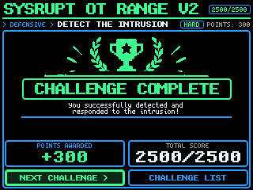
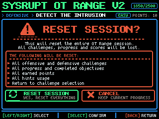

<h1 align="center">SYSRUPT OT Range V2</h1>

<p align="center"><strong>A portable OT/ICS capture-the-flag range that runs entirely on one ESP32-S3 badge.</strong></p>

<p align="center">
  <a href="#build-the-firmware"></a>
  
  
  
  
</p>

A single ESP32-S3 "Vanguard" badge boots its own Wi-Fi access point and *becomes* the control network
of a small simulated industrial site. Join the badge's Wi-Fi, speak each plant's industrial protocol,
and solve a challenge by making the process do what the scenario asks. **11 challenges** spanning
offensive exploitation and defensive investigation/recovery — no external infrastructure, no internet,
no cloud. Progress and scoring are shown on the badge's **320×240 LCD** and persisted on-device.

> **This repository contains no challenge solutions or flags.** The firmware source necessarily includes
> the simulated challenge logic (that is what makes the range playable and testable), but challenge
> walkthroughs, answer keys and solve guides are deliberately kept out of this repository. See
> [Security & authorization](#security--authorization).

> **This is a fork of [Tactility OS](https://tactilityproject.org).** The badge firmware is a Tactility
> *device*, so all SYSRUPT code lives under [`Devices/vanguard/`](Devices/vanguard/). The upstream
> Tactility overview is preserved at [`TACTILITY_UPSTREAM.md`](TACTILITY_UPSTREAM.md).

---

## Contents

[Features](#features) · [Challenges](#challenge-overview) · [Protocols](#protocol-support) ·
[Architecture](#architecture) · [Hardware](#hardware) · [Getting started](#getting-started) ·
[Toolkit](#the-sysrupt-player-toolkit) · [Documentation](#documentation) ·
[Security](#security--authorization) · [Status](#development-status--limitations) ·
[License](#license--attribution)

## Features

- **A self-contained ICS network on one badge** — Modbus/TCP, IEC 60870-5-104, a TriStation-lite safety
  protocol, an OPC-UA-lite service, a GOOSE training stream, SNMP, and a web historian. All are
  **training simulations** (see [Protocol support](#protocol-support)).
- **11 challenges** — 7 offensive, 4 defensive — with difficulty-weighted scoring to a maximum of
  **2500 points**.
- **On-badge LCD interface** — a 320×240 challenge browser with per-challenge story, objectives, two
  optional hint tiers, live status and a shared "challenge complete" screen.
- **Scoring with on-device persistence** — completions are stored in NVS and survive a reboot; only a
  deliberate *Reset Session* clears them.
- **Player-side `sysrupt` toolkit** — a dependency-free Python CLI, served by the badge, that speaks the
  challenge protocols with a four-level verification ladder.
- **Reproducible toolkit packaging** — the downloadable toolkit is embedded in the firmware and verified
  byte-for-byte against the release archive by a host test.
- **Host-side tests** — the simulated plants and protocol logic run under 20 C++ suites (881 checks)
  with no hardware.

<p align="center">
  
  &nbsp;&nbsp;
  
  <br/>
  <em>LCD UI layout references (<code>Devices/vanguard/artifacts/ui/</code>) — design mockups, not photographs of hardware.</em>
</p>

## Challenge overview

Spoiler-free. The full catalogue with objectives is in
[`Devices/vanguard/docs/CHALLENGES.md`](Devices/vanguard/docs/CHALLENGES.md). IDs are not contiguous —
challenge #05 was removed from the live catalogue during de-duplication.

| # | Challenge | Category | Difficulty | Pts | Surface |
|---|---|---|---|---|---|
| 01 | Tripping Breaker | Offensive | Medium | 150 | IEC 60870-5-104 (TCP 2404) |
| 02 | Safety Instrumented Bypass | Offensive | Hard | 250 | TriStation-lite (TCP 1502) |
| 03 | OPC Scout | Offensive | Medium | 150 | OPC-UA-lite (TCP 9005) |
| 04 | Rogue Radio | Offensive | Hard | 200 | Custom pump TCP (7700) |
| 06 | Second Blackout | Offensive | Expert | 300 | GOOSE training (UDP 6180) |
| 11 | Stabilise the Reactor | Offensive | Expert | 300 | Modbus/TCP (502) |
| 12 | Maintenance Override | Offensive | Expert | 300 | Modbus/TCP (502) |
| 07 | Historian SQL Injection | Defensive | Medium | 150 | Web (historian console → `/intranet`) |
| 08 | Field Device Recovery | Defensive | Hard | 350 | SNMP (UDP 161) |
| 09 | Trojan Historian | Defensive | Hard | 250 | Web (`/mail`, `/investigate`) |
| 10 | Device Takeover | Defensive | Hard | 100 | PROFINET DCP (saved evidence) |

**Total attainable: 2500 points** (7 offensive / 4 defensive). These counts and the total are enforced
in source by `static_assert`s and a catalogue test.

## Protocol support

Each service is a **bounded training re-implementation** sized for a no-PSRAM ESP32-S3 and scoped to
teach one concept — not a complete, conformant industry stack. Treat a protocol name as "the concept
this challenge teaches."

| Protocol / surface | Port | In this range | Fidelity |
|---|---|---|---|
| HTTP (HMI, mail, intranet, investigate, `/toolkit.zip`) | TCP 80 | Web UI + defensive surfaces | Simulated web app |
| Modbus/TCP | TCP 502 | Reactor challenges | Function-subset server |
| IEC 60870-5-104 | TCP 2404 | Breaker challenge | Reduced APDU/ASDU set |
| TriStation-lite | TCP 1502 | Safety-controller challenge | Simplified (not Triconex TriStation) |
| OPC-UA-lite | TCP 9005 | OPC Scout | Custom, non-standard (not standard OPC-UA / not 4840) |
| Pump (custom radio) | TCP 7700 | Rogue Radio | Custom legacy-style protocol |
| GOOSE (training) | UDP 6180 | Second Blackout | GOOSE-shaped over UDP, not raw L2 multicast |
| SNMP | UDP 161 | Field Device Recovery | Small agent for the recovery workflow |
| Historian | TCP 9000 | Evidence backend for #07/#09 | Simulated historian |

The historian's SQL-injection challenge uses a **bounded pattern-matching simulator**, intentionally
*not* a real SQL engine. More detail: [`Devices/vanguard/docs/ARCHITECTURE.md`](Devices/vanguard/docs/ARCHITECTURE.md#protocol-realism).

## Architecture

```
Player host (on badge Wi-Fi)  ──HTTP──▶  Web :80  (HMI / mail / intranet / investigate / toolkit.zip)
        │                                   │
        └──industrial protocols──▶  Protocol servers  ──▶  Simulated plants (source/ot/sim)
                                    (Modbus, IEC-104, TriStation,          │
                                     OPC-UA-lite, Pump, GOOSE, SNMP)       ▼
                                                                    "solved?" state
                                                                           │
   LCD UI (source/ui): Challenges.h registry ─▶ menu/views ─▶ scoring ─▶ NVS persistence
```

- `Devices/vanguard/source/ui/Challenges.h` is the **single source of truth** for the catalogue,
  categories, points and completion predicates.
- `startAllServices()` brings up the whole range once at boot, so every challenge is attackable from any
  LCD screen; "solved" state is derived from the simulated plant and detected over the network.
- The web server embeds the toolkit release archive and serves it at `/toolkit.zip`.

A detailed component diagram and dispatch/scoring/persistence description are in
[`Devices/vanguard/docs/ARCHITECTURE.md`](Devices/vanguard/docs/ARCHITECTURE.md).

## Hardware

Authoritative source: the devicetree [`Devices/vanguard/bi0s,vanguard.dts`](Devices/vanguard/bi0s,vanguard.dts)
and [`device.properties`](Devices/vanguard/device.properties). Full detail:
[`Devices/vanguard/docs/HARDWARE.md`](Devices/vanguard/docs/HARDWARE.md).

| | |
|---|---|
| **SoC** | ESP32-S3-WROOM-1, 16 MB flash (DIO), **no PSRAM** |
| **Display** | ST7789, 320×240 landscape, FSPI @ 40 MHz, backlight hardwired on |
| **Input** | 5-way joystick + S1–S5 buttons (all active-low) |
| **Storage** | Internal only (no SD); progress persisted in NVS |
| **Programming** | USB-C serial (e.g. `/dev/ttyACM0`) |
| **Networking** | Wi-Fi AP `SYSRUPT-OT-V2-NNN`, gateway `10.0.1.1`, IPv4 forwarding + NAPT |

This repository contains **no schematic, PCB or CAD files**, and does not claim a custom PCB package.
The LoRa radio, LEDs, buzzer and battery sensing present on the board are **not** driven by the firmware.

## Getting started

### Software you need

- [ESP-IDF **v6.1**](https://docs.espressif.com/projects/esp-idf/) — simplest via Docker image
  `espressif/idf:v6.1`.
- A C++17 compiler (`g++`) for the host tests — no ESP hardware needed.
- Python **3.9+** for the toolkit (standard library only).
- `git` with submodule support.

### Get the source

Libraries under `Libraries/` are **git submodules** pinned to specific revisions
([`SUBMODULES.md`](SUBMODULES.md)):

```bash
git clone --recursive <repo-url>
# or, after a plain clone:
git submodule update --init --recursive
```

### Build the firmware

```bash
docker run --rm -v "$PWD":/project -w /project espressif/idf:v6.1 \
  bash -c "pip install lark && idf.py build"
```

Managed components are fetched from the committed `dependencies.lock` on the first build. Output:
`build/Tactility.bin` (≈ 3.3 MB; the app partition is 6 MB, ~47% free).

### Run the tests

```bash
# C++ host unit tests (no hardware):
cd Devices/vanguard/test && ./run_all.sh

# Python toolkit tests:
cd Devices/vanguard/tools/sysrupt && python3 -m pytest -q
```

### Flash a badge

```bash
./flash_badge.sh -p /dev/ttyACM0 -y     # preserves NVS (saved progress); add --erase for a clean wipe
```

More detail: [`Devices/vanguard/docs/FIRMWARE_DEVELOPMENT.md`](Devices/vanguard/docs/FIRMWARE_DEVELOPMENT.md).

## The `sysrupt` player toolkit

A single dependency-free CLI for the protocol work, served by the badge:

```bash
curl -O http://10.0.1.1/toolkit.zip
unzip toolkit.zip && cd sysrupt-toolkit-1.0.0
./bin/sysrupt help      # grouped command reference (also in COMMANDS.md)
./bin/sysrupt status    # probe the badge's challenge ports (read-only)
```

It speaks Modbus/TCP, IEC-104, TriStation-lite and GOOSE, with a four-level verification ladder
(request → ack → observed state change → challenge completion) and an opt-in timing/sequence engine.
Guide: [`Devices/vanguard/docs/TOOLKIT.md`](Devices/vanguard/docs/TOOLKIT.md) · full command reference:
[`Devices/vanguard/tools/sysrupt/COMMANDS.md`](Devices/vanguard/tools/sysrupt/COMMANDS.md).

The downloadable toolkit is embedded in the firmware and a host test (`ot_toolkitzip_tests`) asserts the
embedded bytes equal the release archive byte-for-byte.

## Documentation

All SYSRUPT documentation lives under
[`Devices/vanguard/docs/`](Devices/vanguard/docs/) ([index](Devices/vanguard/docs/README.md)):

| Topic | Document |
|---|---|
| Architecture | [ARCHITECTURE.md](Devices/vanguard/docs/ARCHITECTURE.md) |
| Hardware | [HARDWARE.md](Devices/vanguard/docs/HARDWARE.md) |
| Firmware development | [FIRMWARE_DEVELOPMENT.md](Devices/vanguard/docs/FIRMWARE_DEVELOPMENT.md) |
| Toolkit | [TOOLKIT.md](Devices/vanguard/docs/TOOLKIT.md) |
| Challenges | [CHALLENGES.md](Devices/vanguard/docs/CHALLENGES.md) |
| Testing | [TESTING.md](Devices/vanguard/docs/TESTING.md) |
| Troubleshooting | [TROUBLESHOOTING.md](Devices/vanguard/docs/TROUBLESHOOTING.md) |
| Development status | [DEVELOPMENT_STATUS.md](Devices/vanguard/docs/DEVELOPMENT_STATUS.md) |
| Player: join the badge | [player-guide/ENVIRONMENT.md](Devices/vanguard/docs/player-guide/ENVIRONMENT.md) |
| Badge provisioning | [BADGE_PROVISIONING.md](Devices/vanguard/docs/BADGE_PROVISIONING.md) |
| Contributing | [CONTRIBUTING.md](CONTRIBUTING.md) · [CODE_OF_CONDUCT.md](CODE_OF_CONDUCT.md) |
| Security policy | [SECURITY.md](SECURITY.md) |

## Security & authorization

This is a **training / CTF simulator**. Its "vulnerabilities," plaintext credentials and insecure
defaults are **intentional challenge fixtures**, confined to the simulated plants on the badge. Use the
offensive tooling here **only** against the authorized badge/lab or systems you have explicit permission
to test — **never** against real industrial equipment or production OT networks.

Challenge walkthroughs, answer keys and solve guides are deliberately **not** in this repository, so a
participant cannot obtain answers by browsing it. To report a *real* vulnerability (as opposed to an
intended CTF weakness), see [`SECURITY.md`](SECURITY.md).

## Development status & limitations

Verified on a host during release preparation — **not** on hardware in this pass. Full breakdown:
[`Devices/vanguard/docs/DEVELOPMENT_STATUS.md`](Devices/vanguard/docs/DEVELOPMENT_STATUS.md).

- ✅ Firmware builds (ESP-IDF v6.1); C++ host tests (20 suites / 881 checks) and Python tests (132) pass;
  embedded toolkit ZIP matches the release archive byte-for-byte.
- 🟡 Protocol servers are training simulations, not full standard stacks; the GOOSE exercise runs over
  UDP; the historian SQLi uses a pattern-matching simulator (not a real SQL engine).
- 🔌 On-device LCD rendering, live-network behavior on hardware, flashing and NVS persistence are **not**
  verified in this release (no automated visual/hardware check exists).
- ❔ Toolkit tested on Linux + Python 3.9+; Windows/macOS are not claimed.

This project is not described as "production-ready" or "secure"; it is a deliberately vulnerable training
tool.

## License & attribution

This project combines code under **two licenses**, and the effective license of the combined/distributed
work is **GPL-3.0**:

- **Tactility base (the OS, drivers, platform)** — GNU **GPL-3.0** ([`LICENSE.md`](LICENSE.md); see
  [`TACTILITY_UPSTREAM.md`](TACTILITY_UPSTREAM.md)).
- **SYSRUPT range code (`Devices/vanguard/`)** — **Apache-2.0** (per the `SPDX-License-Identifier`
  headers and [`Devices/vanguard/LICENSE-Apache-2.0.md`](Devices/vanguard/LICENSE-Apache-2.0.md)).
- **Third-party components** (the `Libraries/` submodules, fonts and assets) retain their own licenses —
  see [`THIRD-PARTY-NOTICES.md`](THIRD-PARTY-NOTICES.md) and [`SUBMODULES.md`](SUBMODULES.md).

Apache-2.0 is one-way compatible with GPL-3.0, so Apache-2.0 SYSRUPT code may be distributed as part of
the GPL-3.0 whole; the aggregate is then governed by GPL-3.0. **This does not make the whole project
permissively licensed.** If you intend to redistribute, confirm the obligations of GPL-3.0 and retain
every upstream notice. This repository does **not** relicense or claim ownership of upstream Tactility or
third-party components.
